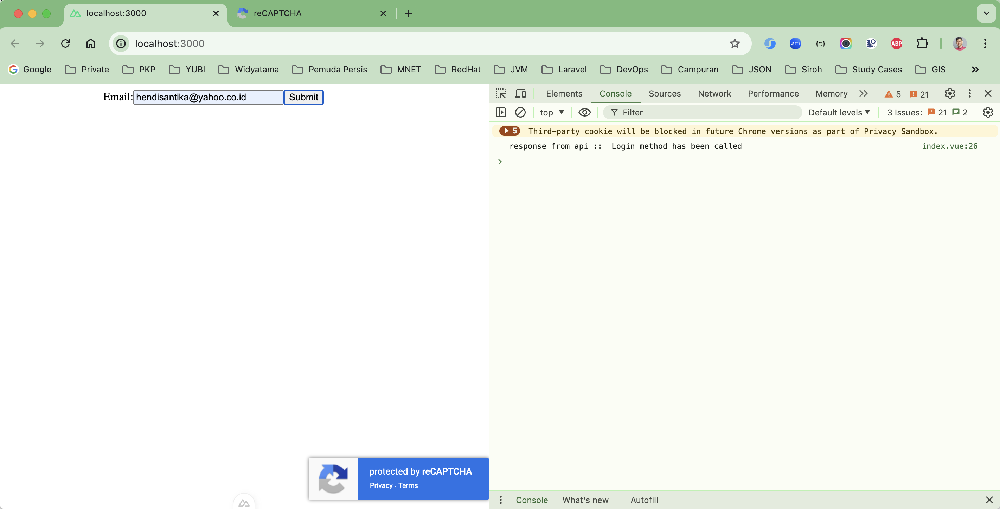
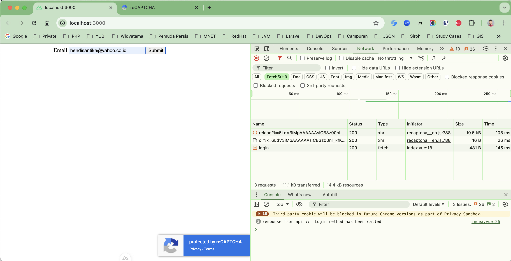

# spring-boot-capcay3-nuxtjs3

[](https://github.com/hendisantika/spring-boot-capcay3-nuxtjs3/actions/workflows/maven.yml)
[](https://github.com/hendisantika/spring-boot-capcay3-nuxtjs3/actions/workflows/node.js.yml)
[](https://github.com/hendisantika/spring-boot-capcay3-nuxtjs3/actions/workflows/docker.yml)


Google reCAPTCHA v3 demo: a **Nuxt 3** frontend gets a reCAPTCHA token and sends it to a **Spring Boot** backend,
which checks it against Google's `siteverify` API before the request reaches the controller.

## Tech Stack

| Layer    | Technology                                                                                 |
|----------|--------------------------------------------------------------------------------------------|
| Backend  | Java 25, Spring Boot 4.1.2 (Web MVC, Security, RestClient, Actuator), Lombok, Maven Wrapper (3.9.16) |
| Frontend | Nuxt 3, Vue 3, `vue-recaptcha-v3`, pnpm                                                    |
| CI/CD    | GitHub Actions (Maven, Node.js and Docker workflows), Dependabot, Docker & Docker Compose  |

## How It Works

1. The frontend (`frontend/composables/useGoogleRecaptcha.ts`) runs reCAPTCHA v3 and gets a token.
2. It calls `POST http://localhost:8080/api/login` with the token in the `google-recaptcha-token` header.
3. `GoogleRecaptchaFilter` catches every URL containing `login` and passes the token to `GoogleRecaptchaService`.
4. The service posts the token to `https://www.google.com/recaptcha/api/siteverify`. A score below `0.5` counts as
   a failure.
5. If the check passes, `LoginController` returns a response. Otherwise `AppControllerAdvice` returns `400 Bad Request`.

## Prerequisites

- JDK **25** (e.g. [Temurin 25](https://adoptium.net/))
- Node.js **22+** and **pnpm** (version comes from `packageManager` in `frontend/package.json`; run `corepack enable`)
- A Google reCAPTCHA **v3** key pair (site key + secret key)

## Configuration

| Variable                           | Used by  | Description                         |
|------------------------------------|----------|-------------------------------------|
| `GOOGLE_RECAPTCHA_SECRET`          | Backend  | reCAPTCHA v3 **secret key** (`.env`, template: `.env.example`) |
| `NUXT_PUBLIC_GOOGLE_RECAPTCHA_KEY` | Frontend | reCAPTCHA v3 **site key** (`frontend/.env`, template: `frontend/.env.example`) |

## Getting Started

1. Clone this repository: `git clone https://github.com/hendisantika/spring-boot-capcay3-nuxtjs3.git`
2. Go to the folder: `cd spring-boot-capcay3-nuxtjs3`
3. Create a Google reCAPTCHA v3 key pair [here](https://www.google.com/recaptcha/admin/create) and add `localhost`
   as a domain.
4. Copy [`.env.example`](.env.example) to `.env` in the project root and put in your **secret key**:
   ```shell
   cp .env.example .env
   ```
   ```dotenv
   GOOGLE_RECAPTCHA_SECRET=your-recaptcha-v3-secret-key
   ```
   Spring Boot loads `.env` through `spring.config.import=optional:file:.env[.properties]`. You can also
   `export GOOGLE_RECAPTCHA_SECRET=...` (or set it in IntelliJ *Run Configuration → Environment variables*). A real
   environment variable wins over `.env`. ⚠️ `.env` is git-ignored, so never commit the real secret key. The app
   logs a warning on startup if the secret is missing.
5. Start the backend (port `8080`):
   ```shell
   ./mvnw clean spring-boot:run
   ```
6. Go to the frontend app: `cd frontend`
7. Copy [`frontend/.env.example`](frontend/.env.example) to `.env` and put in your **site key**:
   ```shell
   cp .env.example .env
   ```
   ```dotenv
   NUXT_PUBLIC_GOOGLE_RECAPTCHA_KEY=your-recaptcha-v3-site-key
   ```
   `.env` is git-ignored. Only `.env.example` is committed.
8. Install the dependencies: `pnpm install`
9. Start the web app: `pnpm dev`
10. Open your browser at http://localhost:3000

## Run with Docker

The repo has a multi-stage [`Dockerfile`](Dockerfile) for the backend (Temurin JDK 25 build, JRE 25 runtime,
Spring Boot layered jar), a [`frontend/Dockerfile`](frontend/Dockerfile) (Node 24 + pnpm build, Nitro server
runtime) and a [`docker-compose.yml`](docker-compose.yml) that runs both. Both containers run as non-root users.

1. Create the env files from the templates and fill in your keys:
   ```shell
   cp .env.example .env                    # GOOGLE_RECAPTCHA_SECRET
   cp frontend/.env.example frontend/.env  # NUXT_PUBLIC_GOOGLE_RECAPTCHA_KEY
   ```
2. Build and start:
   ```shell
   docker compose up --build -d
   ```
3. Open http://localhost:3000. The backend listens on http://localhost:8080.
4. Stop: `docker compose down`

Notes:

- The env files are passed to the containers at runtime (`env_file`). They are never copied into the images
  (see the `.dockerignore` files).
- The frontend calls the backend from the browser at `http://localhost:8080`, so keep port `8080` published.
- Both services have a healthcheck: backend `GET /actuator/health/readiness` (Spring Boot Actuator, only the
  `health` endpoint is exposed) and frontend `GET /`. The frontend starts only after the backend is healthy.
  Use `docker compose ps` to see the status, or `docker compose up --build -d --wait` to block until both are
  healthy.
- You can also build the images one by one: `docker build -t capcay3-backend .` and
  `docker build -t capcay3-frontend ./frontend`.

## Build & Test

```shell
# Backend: compile, run tests, package the jar
./mvnw clean verify

# Frontend: production build
cd frontend && pnpm install --frozen-lockfile && pnpm build
```

## Continuous Integration

| Workflow                                                 | Runs when                                           | What it does                                                         |
|----------------------------------------------------------|-----------------------------------------------------|----------------------------------------------------------------------|
| [`maven.yml`](.github/workflows/maven.yml)               | push/PR to `main` (skips `frontend/**`, docs, imgs) | Sets up Temurin JDK 25 and runs `./mvnw -B -ntp clean verify`        |
| [`node.js.yml`](.github/workflows/node.js.yml)           | push/PR to `main` touching `frontend/**`            | pnpm install with `--frozen-lockfile` and `pnpm build` on Node 22.x and 24.x |
| [`docker.yml`](.github/workflows/docker.yml)             | push/PR to `main` touching Dockerfiles, compose, backend or frontend sources | Builds both images with Buildx (GHA cache, no push), then runs `docker compose up --wait` until both healthchecks pass and smoke tests them (`/actuator/health` is UP, `POST /api/login` returns 400 without a token, frontend renders the form) |

All workflows can also be started by hand (`workflow_dispatch`). They use read-only permissions and cancel
older runs on the same branch.

## Dependabot

[`.github/dependabot.yml`](.github/dependabot.yml) keeps dependencies up to date:

| Ecosystem      | Directory   | Schedule                   | Grouping                                          |
|----------------|-------------|----------------------------|---------------------------------------------------|
| Maven          | `/`         | daily, 05:00 Asia/Jakarta  | `spring-boot` and `maven-minor-patch` (minor/patch) |
| npm (pnpm)     | `/frontend` | daily, 05:00 Asia/Jakarta  | `nuxt-vue` and `npm-minor-patch` (minor/patch)      |
| GitHub Actions | `/`         | weekly, Monday 05:00       | all actions in one PR                             |
| Docker         | `/`, `/frontend` | weekly, Monday 05:00  | base images (`eclipse-temurin`, `node` LTS only) |

Major updates still get their own PRs. Each PR is labeled, uses a conventional commit prefix
(`build(deps)`, `build(deps-dev)`, `ci(deps)`) and waits 3 days after a release before it opens.

## Image Screenshots

Home Page





## Console Log (sample, recorded on an earlier Spring Boot 3.3.2 / Java 21 version)

```shell
/Users/hendisantika/.sdkman/candidates/java/21.0.1-tem/bin/java -XX:TieredStopAtLevel=1 -Dspring.output.ansi.enabled=always -Dcom.sun.management.jmxremote -Dspring.jmx.enabled=true -Dspring.liveBeansView.mbeanDomain -Dspring.application.admin.enabled=true -Dmanagement.endpoints.jmx.exposure.include=* -javaagent:/Users/hendisantika/Applications/IntelliJ IDEA Ultimate.app/Contents/lib/idea_rt.jar=49478:/Users/hendisantika/Applications/IntelliJ IDEA Ultimate.app/Contents/bin -Dfile.encoding=UTF-8 -Dsun.stdout.encoding=UTF-8 -Dsun.stderr.encoding=UTF-8 -classpath /Users/hendisantika/IdeaProjects/spring-boot-capcay3-nuxtjs3/target/classes:/Users/hendisantika/.m2/repository/org/springframework/boot/spring-boot-starter-web/3.3.2/spring-boot-starter-web-3.3.2.jar:/Users/hendisantika/.m2/repository/org/springframework/boot/spring-boot-starter/3.3.2/spring-boot-starter-3.3.2.jar:/Users/hendisantika/.m2/repository/org/springframework/boot/spring-boot-starter-logging/3.3.2/spring-boot-starter-logging-3.3.2.jar:/Users/hendisantika/.m2/repository/ch/qos/logback/logback-classic/1.5.6/logback-classic-1.5.6.jar:/Users/hendisantika/.m2/repository/ch/qos/logback/logback-core/1.5.6/logback-core-1.5.6.jar:/Users/hendisantika/.m2/repository/org/apache/logging/log4j/log4j-to-slf4j/2.23.1/log4j-to-slf4j-2.23.1.jar:/Users/hendisantika/.m2/repository/org/apache/logging/log4j/log4j-api/2.23.1/log4j-api-2.23.1.jar:/Users/hendisantika/.m2/repository/org/slf4j/jul-to-slf4j/2.0.13/jul-to-slf4j-2.0.13.jar:/Users/hendisantika/.m2/repository/jakarta/annotation/jakarta.annotation-api/2.1.1/jakarta.annotation-api-2.1.1.jar:/Users/hendisantika/.m2/repository/org/yaml/snakeyaml/2.2/snakeyaml-2.2.jar:/Users/hendisantika/.m2/repository/org/springframework/boot/spring-boot-starter-json/3.3.2/spring-boot-starter-json-3.3.2.jar:/Users/hendisantika/.m2/repository/com/fasterxml/jackson/core/jackson-databind/2.17.2/jackson-databind-2.17.2.jar:/Users/hendisantika/.m2/repository/com/fasterxml/jackson/core/jackson-annotations/2.17.2/jackson-annotations-2.17.2.jar:/Users/hendisantika/.m2/repository/com/fasterxml/jackson/core/jackson-core/2.17.2/jackson-core-2.17.2.jar:/Users/hendisantika/.m2/repository/com/fasterxml/jackson/datatype/jackson-datatype-jdk8/2.17.2/jackson-datatype-jdk8-2.17.2.jar:/Users/hendisantika/.m2/repository/com/fasterxml/jackson/datatype/jackson-datatype-jsr310/2.17.2/jackson-datatype-jsr310-2.17.2.jar:/Users/hendisantika/.m2/repository/com/fasterxml/jackson/module/jackson-module-parameter-names/2.17.2/jackson-module-parameter-names-2.17.2.jar:/Users/hendisantika/.m2/repository/org/springframework/boot/spring-boot-starter-tomcat/3.3.2/spring-boot-starter-tomcat-3.3.2.jar:/Users/hendisantika/.m2/repository/org/apache/tomcat/embed/tomcat-embed-core/10.1.26/tomcat-embed-core-10.1.26.jar:/Users/hendisantika/.m2/repository/org/apache/tomcat/embed/tomcat-embed-el/10.1.26/tomcat-embed-el-10.1.26.jar:/Users/hendisantika/.m2/repository/org/apache/tomcat/embed/tomcat-embed-websocket/10.1.26/tomcat-embed-websocket-10.1.26.jar:/Users/hendisantika/.m2/repository/org/springframework/spring-web/6.1.11/spring-web-6.1.11.jar:/Users/hendisantika/.m2/repository/org/springframework/spring-beans/6.1.11/spring-beans-6.1.11.jar:/Users/hendisantika/.m2/repository/io/micrometer/micrometer-observation/1.13.2/micrometer-observation-1.13.2.jar:/Users/hendisantika/.m2/repository/io/micrometer/micrometer-commons/1.13.2/micrometer-commons-1.13.2.jar:/Users/hendisantika/.m2/repository/org/springframework/spring-webmvc/6.1.11/spring-webmvc-6.1.11.jar:/Users/hendisantika/.m2/repository/org/springframework/spring-context/6.1.11/spring-context-6.1.11.jar:/Users/hendisantika/.m2/repository/org/springframework/spring-expression/6.1.11/spring-expression-6.1.11.jar:/Users/hendisantika/.m2/repository/org/springframework/boot/spring-boot-starter-security/3.3.2/spring-boot-starter-security-3.3.2.jar:/Users/hendisantika/.m2/repository/org/springframework/spring-aop/6.1.11/spring-aop-6.1.11.jar:/Users/hendisantika/.m2/repository/org/springframework/security/spring-security-config/6.3.1/spring-security-config-6.3.1.jar:/Users/hendisantika/.m2/repository/org/springframework/security/spring-security-web/6.3.1/spring-security-web-6.3.1.jar:/Users/hendisantika/.m2/repository/org/springframework/boot/spring-boot-devtools/3.3.2/spring-boot-devtools-3.3.2.jar:/Users/hendisantika/.m2/repository/org/springframework/boot/spring-boot/3.3.2/spring-boot-3.3.2.jar:/Users/hendisantika/.m2/repository/org/springframework/boot/spring-boot-autoconfigure/3.3.2/spring-boot-autoconfigure-3.3.2.jar:/Users/hendisantika/.m2/repository/org/springframework/boot/spring-boot-configuration-processor/3.3.2/spring-boot-configuration-processor-3.3.2.jar:/Users/hendisantika/.m2/repository/org/projectlombok/lombok/1.18.34/lombok-1.18.34.jar:/Users/hendisantika/.m2/repository/org/slf4j/slf4j-api/2.0.13/slf4j-api-2.0.13.jar:/Users/hendisantika/.m2/repository/org/springframework/spring-core/6.1.11/spring-core-6.1.11.jar:/Users/hendisantika/.m2/repository/org/springframework/spring-jcl/6.1.11/spring-jcl-6.1.11.jar:/Users/hendisantika/.m2/repository/org/springframework/security/spring-security-core/6.3.1/spring-security-core-6.3.1.jar:/Users/hendisantika/.m2/repository/org/springframework/security/spring-security-crypto/6.3.1/spring-security-crypto-6.3.1.jar id.my.hendisantika.capcay3.SpringBootCapcay3Nuxtjs3Application

  .   ____          _            __ _ _
 /\\ / ___'_ __ _ _(_)_ __  __ _ \ \ \ \
( ( )\___ | '_ | '_| | '_ \/ _` | \ \ \ \
 \\/  ___)| |_)| | | | | || (_| |  ) ) ) )
  '  |____| .__|_| |_|_| |_\__, | / / / /
 =========|_|==============|___/=/_/_/_/

 :: Spring Boot ::                (v3.3.2)

2024-08-01T11:05:22.316+07:00  INFO 92163 --- [spring-boot-capcay3-nuxtjs3] [  restartedMain] .h.c.SpringBootCapcay3Nuxtjs3Application : Starting SpringBootCapcay3Nuxtjs3Application using Java 21.0.1 with PID 92163 (/Users/hendisantika/IdeaProjects/spring-boot-capcay3-nuxtjs3/target/classes started by hendisantika in /Users/hendisantika/IdeaProjects/spring-boot-capcay3-nuxtjs3)
2024-08-01T11:05:22.317+07:00  INFO 92163 --- [spring-boot-capcay3-nuxtjs3] [  restartedMain] .h.c.SpringBootCapcay3Nuxtjs3Application : No active profile set, falling back to 1 default profile: "default"
2024-08-01T11:05:22.333+07:00  INFO 92163 --- [spring-boot-capcay3-nuxtjs3] [  restartedMain] .e.DevToolsPropertyDefaultsPostProcessor : Devtools property defaults active! Set 'spring.devtools.add-properties' to 'false' to disable
2024-08-01T11:05:22.334+07:00  INFO 92163 --- [spring-boot-capcay3-nuxtjs3] [  restartedMain] .e.DevToolsPropertyDefaultsPostProcessor : For additional web related logging consider setting the 'logging.level.web' property to 'DEBUG'
2024-08-01T11:05:22.635+07:00  INFO 92163 --- [spring-boot-capcay3-nuxtjs3] [  restartedMain] o.s.b.w.embedded.tomcat.TomcatWebServer  : Tomcat initialized with port 8080 (http)
2024-08-01T11:05:22.643+07:00  INFO 92163 --- [spring-boot-capcay3-nuxtjs3] [  restartedMain] o.apache.catalina.core.StandardService   : Starting service [Tomcat]
2024-08-01T11:05:22.643+07:00  INFO 92163 --- [spring-boot-capcay3-nuxtjs3] [  restartedMain] o.apache.catalina.core.StandardEngine    : Starting Servlet engine: [Apache Tomcat/10.1.26]
2024-08-01T11:05:22.657+07:00  INFO 92163 --- [spring-boot-capcay3-nuxtjs3] [  restartedMain] o.a.c.c.C.[Tomcat].[localhost].[/]       : Initializing Spring embedded WebApplicationContext
2024-08-01T11:05:22.657+07:00  INFO 92163 --- [spring-boot-capcay3-nuxtjs3] [  restartedMain] w.s.c.ServletWebServerApplicationContext : Root WebApplicationContext: initialization completed in 323 ms
2024-08-01T11:05:22.724+07:00  WARN 92163 --- [spring-boot-capcay3-nuxtjs3] [  restartedMain] .s.s.UserDetailsServiceAutoConfiguration : 

Using generated security password: 55467bed-1c4c-4532-ae06-6cd5e7615061

This generated password is for development use only. Your security configuration must be updated before running your application in production.

2024-08-01T11:05:22.731+07:00  INFO 92163 --- [spring-boot-capcay3-nuxtjs3] [  restartedMain] r$InitializeUserDetailsManagerConfigurer : Global AuthenticationManager configured with UserDetailsService bean with name inMemoryUserDetailsManager
2024-08-01T11:05:22.803+07:00  INFO 92163 --- [spring-boot-capcay3-nuxtjs3] [  restartedMain] o.s.b.d.a.OptionalLiveReloadServer       : LiveReload server is running on port 35729
2024-08-01T11:05:22.813+07:00  INFO 92163 --- [spring-boot-capcay3-nuxtjs3] [  restartedMain] o.s.b.w.embedded.tomcat.TomcatWebServer  : Tomcat started on port 8080 (http) with context path '/'
2024-08-01T11:05:22.817+07:00  INFO 92163 --- [spring-boot-capcay3-nuxtjs3] [  restartedMain] .h.c.SpringBootCapcay3Nuxtjs3Application : Started SpringBootCapcay3Nuxtjs3Application in 0.639 seconds (process running for 0.939)
2024-08-01T11:05:30.187+07:00  INFO 92163 --- [spring-boot-capcay3-nuxtjs3] [nio-8080-exec-1] o.a.c.c.C.[Tomcat].[localhost].[/]       : Initializing Spring DispatcherServlet 'dispatcherServlet'
2024-08-01T11:05:30.187+07:00  INFO 92163 --- [spring-boot-capcay3-nuxtjs3] [nio-8080-exec-1] o.s.web.servlet.DispatcherServlet        : Initializing Servlet 'dispatcherServlet'
2024-08-01T11:05:30.188+07:00  INFO 92163 --- [spring-boot-capcay3-nuxtjs3] [nio-8080-exec-1] o.s.web.servlet.DispatcherServlet        : Completed initialization in 1 ms
2024-08-01T11:05:30.465+07:00  INFO 92163 --- [spring-boot-capcay3-nuxtjs3] [nio-8080-exec-2] i.m.h.c.service.GoogleRecaptchaService   : Recaptcha verification completed successfully
2024-08-01T11:05:30.465+07:00  INFO 92163 --- [spring-boot-capcay3-nuxtjs3] [nio-8080-exec-2] i.m.h.c.service.GoogleRecaptchaService   : Recaptcha response: GoogleRecaptchaResponse(success=true, challenge_ts=2024-08-01T04:02:33Z, hostname=localhost, errorCodes=null, score=0.9, action=login)
2024-08-01T11:05:33.917+07:00  INFO 92163 --- [spring-boot-capcay3-nuxtjs3] [nio-8080-exec-3] i.m.h.c.service.GoogleRecaptchaService   : Recaptcha verification completed successfully
2024-08-01T11:05:33.917+07:00  INFO 92163 --- [spring-boot-capcay3-nuxtjs3] [nio-8080-exec-3] i.m.h.c.service.GoogleRecaptchaService   : Recaptcha response: GoogleRecaptchaResponse(success=true, challenge_ts=2024-08-01T04:02:33Z, hostname=localhost, errorCodes=null, score=0.9, action=login)
2024-08-01T11:09:33.686+07:00  INFO 92163 --- [spring-boot-capcay3-nuxtjs3] [nio-8080-exec-5] i.m.h.c.service.GoogleRecaptchaService   : Recaptcha verification completed successfully
2024-08-01T11:09:33.686+07:00  INFO 92163 --- [spring-boot-capcay3-nuxtjs3] [nio-8080-exec-5] i.m.h.c.service.GoogleRecaptchaService   : Recaptcha response: GoogleRecaptchaResponse(success=true, challenge_ts=2024-08-01T04:02:33Z, hostname=localhost, errorCodes=null, score=0.9, action=login)

```
